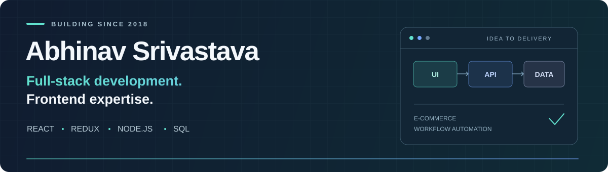

  

  <strong>Senior Software Engineer at Lowe's India</strong> 
  Bengaluru, India · Building web applications since 2018

  <a href="https://www.linkedin.com/in/abhinavsrivastava17/">LinkedIn</a> ·
  <a href="mailto:abhinavsrivastava1705@gmail.com">Email</a> ·
  <a href="https://github.com/abhisri17?tab=repositories">Repositories</a>

## About me

I'm Abhinav, a software engineer focused on **full-stack web development, with deep frontend expertise** in React, Redux, and JavaScript. I build enterprise web applications across e-commerce, workflow automation, supply chain, and real-time monitoring.

My strongest work sits at the intersection of product experience and engineering: translating requirements into usable interfaces, building reusable components, integrating APIs, and carrying features through testing, deployment, and maintenance. Alongside my frontend experience, I work with Node.js, SQL, REST API integration, and CI/CD.

- **Currently:** Senior Software Engineer at Lowe's India, working on workflow automation and reusable UI systems.
- **Previously:** Software Engineer at Lowe's India and EPAM Systems; engineering roles at Tata Consultancy Services.
- **Team contribution:** Mentoring developers through onboarding, code reviews, pair programming, and technical training.
- **Engineering interests:** Full-stack applications, component architecture, workflow automation, and generative AI.

## Selected impact

| Product experience | Engineering efficiency | Team growth |
| :--- | :--- | :--- |
| Built responsive e-commerce features that improved user engagement by **15%**. | Led a reusable component migration that reduced code duplication by **40%**. | Delivered developer onboarding and technical guidance over a **6-month** period. |

## Technical toolkit

| Area | Technologies and practices |
| :--- | :--- |
| **Frontend expertise** | React, Redux, JavaScript (ES6+), HTML5, CSS3, Material UI, Progressive Web Apps |
| **Backend & data** | Node.js, SQL, stored procedures, REST API integration |
| **Delivery & tooling** | Git, CI/CD, Postman, Grafana, Camunda BPM, Visual Studio Code |
| **Engineering foundations** | Data structures, algorithms, object-oriented programming, SDLC, Agile, DevOps |
| **Collaboration** | Code reviews, mentoring, pair programming, cross-functional delivery |

## Selected professional work

### Workflow automation tool - Camunda
**Lowe's India · Sep 2024 - Present**

Built the core React and Redux interface for a workflow automation tool. Developed reusable components for task management and team coordination to streamline business processes and improve development velocity.

### Feedback Management System
**Lowe's India · Sep 2022 - Sep 2024**

Developed a customizable feedback application with modular plugin extensions. Used React and Material UI to deliver feedback experiences through modals and pop-ups.

### Suppliers Collaboration Product
**EPAM Systems · Jun 2022 - Sep 2022**

Developed a React PWA for vendor operations and integrated RESTful APIs with backend teams. Automated inventory management, data entry, and report generation.

<strong>Explore more professional projects</strong>

| Project | Period | Contribution |
| :--- | :--- | :--- |
| **E-commerce B2C Progressive Web App** | Jun 2021 - Jun 2022 | Built React features for B2C product browsing, selection, and checkout. |
| **BizOps Flow Hub** | Nov 2020 - May 2021 | Developed administrative interfaces for price updates and user access management. |
| **Grant View B2C Portal Enhancement** | Jun 2020 - Nov 2020 | Created dynamic React reporting with user-defined attributes and downloadable reports; resolved frontend issues. |
| **RIB Monitoring Dashboard** | Jun 2019 - May 2020 | Built a React PWA for real-time database transaction monitoring, live insights, and batch-processing fault notifications. |
| **FitCommerce Experience Enhancement** | Nov 2018 - May 2019 | Developed React interfaces and SQL stored procedures for a retail application; contributed to planning and requirements gathering. |

## Career journey

| Role | Organization | Period |
| :--- | :--- | :--- |
| **Senior Software Engineer** | Lowe's India | Sep 2024 - Present |
| **Software Engineer** | Lowe's India | Sep 2022 - Sep 2024 |
| **Software Engineer** | EPAM Systems | Jun 2022 - Sep 2022 |
| **Systems Engineer** | Tata Consultancy Services | Mar 2020 - Jun 2022 |
| **Assistant Systems Engineer** | Tata Consultancy Services | Nov 2018 - Mar 2020 |

## Recognition

**Lowe's Individual Excellence Award** · **Lowe's Team Excellence Award** · **Lowe's Spot Award**

<strong>Education, certifications & languages</strong>

### Education

**B.Tech in Information Technology**  
Cochin University of Science and Technology, Kochi · 2014 - 2018  
Graduated May 2018 · CGPA: 7.55/10

Coursework: Data Structures, Algorithms, Database Management Systems, and Object-Oriented Programming.

**High School, Science**  
City Montessori School · 2001 - 2013

### Certifications & courses

- JavaScript, HTML and CSS Web Development
- React - The Complete Guide (incl Hooks, React Router, Redux)
- Angular - The Complete Guide (2020 Edition)
- Problem Solving (Basic)

### Languages

English (Full Professional) · Hindi (Native or Bilingual)

---

**Let's connect.** I'm interested in conversations about full-stack development, frontend architecture, and workflow automation. Reach me on [LinkedIn](https://www.linkedin.com/in/abhinavsrivastava17/) or by [email](mailto:abhinavsrivastava1705@gmail.com).
